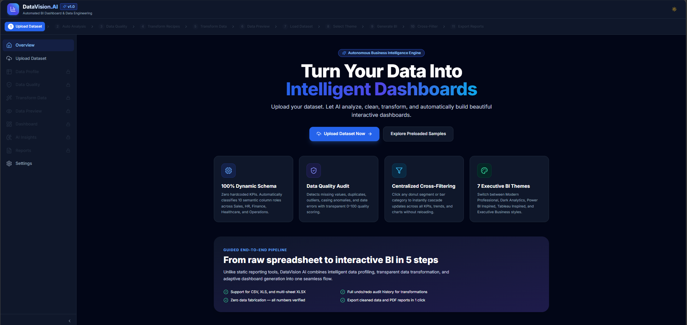
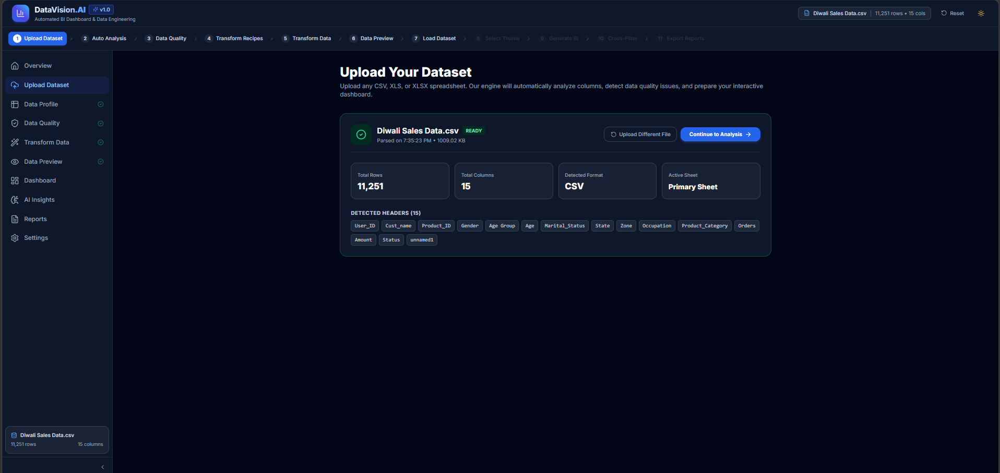
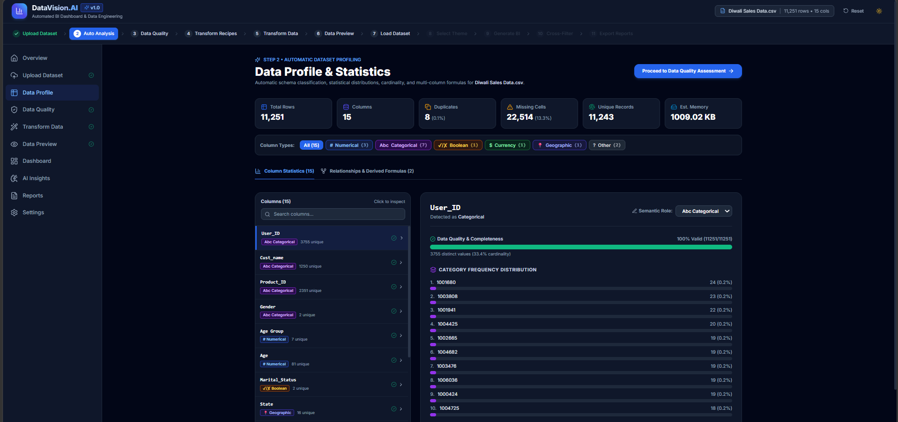
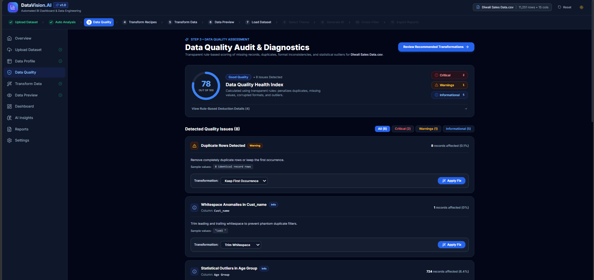
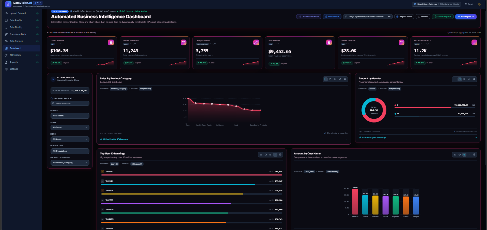
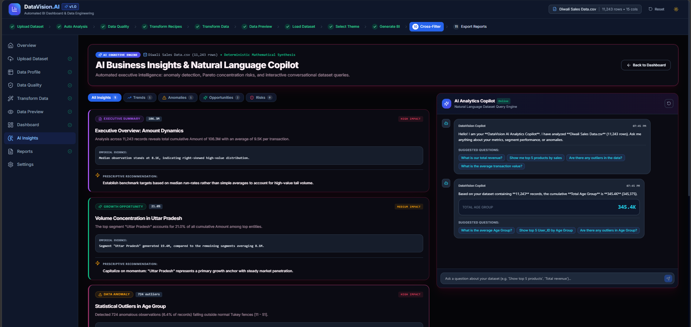
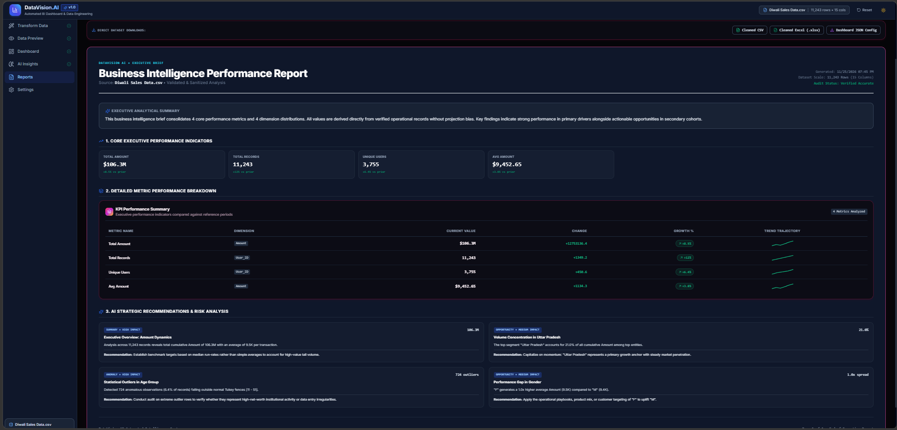

# DataVision AI – Automated Business Intelligence Dashboard Generator

**Transform raw datasets into interactive business dashboards and actionable insights — automatically.**

DataVision AI is a client-side analytics platform that converts CSV and Excel files into interactive dashboards through automated data profiling, data cleaning, visualization recommendations, and AI-powered insights.

 

## Key Features

- **Smart Data Upload:** Import CSV files and multi-sheet Excel workbooks.
- **Automated Data Profiling:** Detect data types, distributions, correlations, and statistical patterns.
- **Data Quality Analysis:** Identify missing values, duplicates, inconsistencies, and outliers.
- **Data Transformation:** Apply cleaning operations with before-and-after previews and undo/redo support.
- **Automated Dashboard Generation:** Generate KPIs and visualizations based on the uploaded dataset.
- **Interactive Visualizations:** Explore charts with cross-filtering, slicers, and drill-down functionality.
- **AI-Powered Insights:** Discover trends, anomalies, opportunities, and business risks.
- **Natural Language Queries:** Ask questions about your dataset using a built-in query engine.
- **Custom Dashboard Builder:** Create custom KPIs and charts.
- **Export & Reporting:** Export cleaned datasets, Excel reports, CSV, JSON, and PDF reports.

## Website Screenshots

<!-- Add screenshots captured from your actual application -->

| Data Upload | Data Profiling |
|---|---|
|  | ) |

| Data Quality Analysis | Interactive Dashboard |
|---|---|
|  |  |

| AI Insights | Report |
|---|---|
|  |  |

## Technology Stack

| Category | Technologies |
|---|---|
| Frontend | React, TypeScript, Vite |
| Styling | Tailwind CSS |
| Data Processing | PapaParse, SheetJS |
| Visualizations | Custom SVG Charts |
| State Management | React Context API |
| Browser Storage | LocalStorage |
| Deployment | Vercel |
| Version Control | Git, GitHub |

## Privacy & Architecture

- 100% client-side data processing.
- Uploaded raw datasets remain within the browser.
- No backend database or external AI API required.
- Dynamic KPIs, charts, and insights are computed from uploaded data.
- Data exports include formula-injection sanitization.

## Getting Started

```bash
# Clone the repository
git clone YOUR_GITHUB_REPOSITORY_URL

# Navigate into the project
cd YOUR_PROJECT_DIRECTORY

# Install dependencies
npm install

# Start development server
npm run dev

# Build for production
npm run build
```

## Deployment

The application is deployed using **Vercel**.

**Live Demo:** https://datavision-ai-steel.vercel.app/

## Project Highlights

- Built an end-to-end automated BI workflow covering data ingestion, profiling, cleaning, visualization, and reporting.
- Developed reusable data-processing services and dynamic dashboard components.
- Implemented interactive cross-filtering and drill-down analytics.
- Designed a privacy-focused, browser-based architecture.
- Successfully built and deployed the application.

## Future Enhancements

- Advanced natural language analytics.
- Additional visualization types.
- More dashboard templates.
- Enhanced forecasting and predictive analytics.

---

**Developed with React, TypeScript, and a focus on making business analytics simpler and more accessible.**
