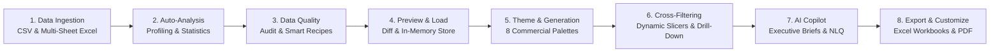

# DataVision AI — Automated Business Intelligence & Dashboard Generator

[](https://reactjs.org/)
[](https://www.typescriptlang.org/)
[](https://vitejs.dev/)
[](https://tailwindcss.com/)
[](https://opensource.org/licenses/MIT)

**DataVision AI** is an enterprise-grade, automated Business Intelligence (BI) and data engineering web application. It ingests raw CSV or multi-sheet Excel files, autonomously profiles schemas and data distributions, audits quality with self-healing transformation recipes, and generates interactive, cross-filtered executive dashboards paired with an AI-driven Natural Language Query (NLQ) copilot and multi-format reporting suite.

Zero hardcoded numbers. Zero mock data. 100% computed from your actual operational records.

---

## 🚀 Key Highlights & Architecture



---

## ⚡ The 8 Implementation Phases

### 1. Multi-Format Data Ingestion
- **Formats Supported**: CSV (RFC 4180 with auto-detection for `,`, `;`, `\t`, `|` delimiters) and Excel (`.xlsx`, `.xls` via SheetJS).
- **Multi-Sheet Workbook Inspection**: Interactive worksheet selection modal allowing users to select individual tabs (e.g., *Orders*, *Customers*, *Products*).
- **Enterprise Sample Datasets**: Instant one-click loading for 5 realistic domains (Retail E-Commerce, SaaS Financial Growth, HR Workforce, Healthcare Clinical Ops, Multi-Product Sales).
- **Client-Side Privacy**: All processing runs locally in browser memory—zero dataset records are uploaded to external third-party servers.

### 2. Autonomous Dataset Analysis & Profiling
- **Semantic Type Classification**: High-accuracy heuristic profiling for Numerical, Datetime, Categorical, Boolean, Currency, Percentage, and Entity Identifiers.
- **Descriptive Statistical Engine**: Computes Count, Null Count, Distinct Count, Min, Max, Mean, Median, Standard Deviation, Interquartile Range (IQR), Quartiles (Q1, Q3), and Skewness.
- **Relationship Discovery**: Detects Primary Key candidates, Foreign Key dimensions, Hierarchical groupings, and Pearson Correlation matrices.
- **User Overrides**: Interactive manual dropdowns to override any inferred semantic type.

### 3. Data Quality Audit & Self-Healing Transformations
- **Composite Quality Scoring (0–100)**: Multi-factor health scoring across Completeness, Uniqueness, Consistency, and Validity.
- **Smart Primary Key vs. Foreign Key Distinctions**: Accurately recognizes that repeated customer IDs or product IDs in transaction tables are valid relational foreign keys, eliminating false duplicate warnings.
- **Automated Transformation Recipes**:
  - Impute missing values (Mean, Median, Mode, Forward Fill, Custom Constant).
  - Outlier treatment (Capping via IQR boundary thresholds).
  - Row and column pruning, string normalization, and date standardization.
- **Full Audit Ledger**: Complete Undo/Redo capability with immutable historical snapshots.

### 4. Interactive Data Preview & In-Memory Store
- **Before-vs-After Diff Comparison**: Side-by-side verification of transformed records against raw source data.
- **Virtualized Responsive Table**: Client-side pagination, global search, column visibility toggles, and multi-column sorting.
- **Inline Cell Editing**: Surgical, single-cell manual corrections with instant recalculation.
- **State Commitment**: Locks verified datasets into the reactive BI store.

### 5. Multi-Theme Dynamic Dashboard Generation
- **8 Commercial Visual Themes**:
  1. **Modern Professional**: Clean slate corporate design with subtle elevation.
  2. **Dark Analytics**: High-contrast dark navy backdrop with vibrant violet accents.
  3. **Power BI Enterprise**: Classic BI layout with structured cards and gold/yellow highlights.
  4. **Tableau Visionary**: Balanced neutral backdrop with a 10-color categorical palette.
  5. **Emerald Prestige**: C-suite royal emerald slate with gold and mint highlights.
  6. **Cosmic Aurora**: Deep indigo/purple gradient glow with expressive hierarchy.
  7. **Tokyo Synthwave**: Cyberpunk neon dark aesthetic.
  8. **Custom Studio**: Fully personalized primary brand colors and custom background themes.
- **Dynamic Executive KPIs**: Totals, Averages, Counts, Volume, and Period-over-Period variance indicators.
- **6 Dynamic SVG Visualizations**:
  - Time-Series Area/Line Trend Chart.
  - Proportional Donut Chart with center metric.
  - Top-N Ranked Horizontal Bar Chart.
  - Categorical Comparison Bar Chart.
  - Measure-to-Measure Scatter Correlation Plot.
  - KPI Performance Summary Table with inline SVG sparklines.

### 6. Global Interactivity & Cross-Filtering
- **Chart Slice Cross-Filtering**: Clicking any chart slice or bar instantly filters the entire dashboard.
- **Reactive Dynamic KPIs**: All KPI cards, sparklines, and dependent charts recalculate dynamically against the filtered row subset.
- **Multi-Dimension Slicer Panel**: Collapsible sidebar with dropdown filters, date-range picker, and full-text keyword search.
- **Active Filter Ribbon**: Individual filter removal chips and a 1-click "Clear All" action with row count indicators.
- **Raw Record Drill-Down Modal**: Deep-dive inspection table displaying raw records powering any specific chart slice.

### 7. AI Executive Insights & Natural Language Copilot
- **Automated Executive Narrative**: Real-time summary synthesizing top drivers, revenue concentration, performance trajectories, and risk cohorts.
- **Categorized Insight Cards**: Anomaly alerts, Pareto distribution warnings, trajectory forecasts, and prescriptive strategic recommendations.
- **Natural Language Query (NLQ) Assistant**: Conversational dataset querying without SQL (e.g., *"What is total sales?"*, *"Show top 5 customers by price"*, *"Compare payment methods"*).

### 8. Customization, Persistence & Multi-Format Exporter
- **Custom KPI Creator**: Build bespoke metrics with custom titles, columns, aggregations (`sum`, `avg`, `count`, `count_distinct`, `min`, `max`), and formatting (`currency`, `number`, `percentage`, `compact`) with real-time preview.
- **Custom Chart Builder**: Construct custom visualizations by mapping dimensions, measures, and chart types into the dashboard.
- **Template Management**: Save layouts to browser `localStorage` and import/export dashboard templates as JSON files.
- **Multi-Sheet Formatted Excel BI Workbook**: Generates a 4-sheet formatted `.xlsx` report (`Executive_KPIs`, `Dimension_Breakdowns`, `AI_Recommendations`, `Dataset_Records`) with enterprise formula-injection defense.
- **Print-Ready PDF Brief**: Native `@media print` layout eliminating navigation chrome and optimizing contrast and page breaks for C-suite executive printouts.
- **Direct Downloads**: Sanitized Cleaned CSV, Cleaned Excel (.xlsx), and Dashboard JSON configs.

---

## 🛠️ Tech Stack

- **Framework**: React 18 (TypeScript)
- **Bundler**: Vite 6
- **Styling**: Tailwind CSS, PostCSS, Lucide React Icons
- **Data Parsing & Exporting**: SheetJS (`xlsx`), PapaParse
- **Math & Stat Engines**: Custom descriptive statistics, IQR anomaly detection, Pearson correlation algorithms
- **State Management**: React Context API with non-destructive immutable action history

---

## 💻 Local Setup & Development

### Prerequisites
- Node.js (v18.0.0 or higher)
- npm or yarn

### Installation
```bash
# Clone the repository
git clone https://github.com/YOUR_USERNAME/datavision-ai.git
cd datavision-ai/frontend

# Install dependencies
npm install

# Start development server
npm run dev
```
Open [http://localhost:5173](http://localhost:5173) in your browser.

### Production Build & Type-Check
```bash
# Typecheck and build minified bundle
npm run build

# Preview production build locally
npm run preview
```

---

## ☁️ Deployment

### Deploy to Vercel

#### Option 1: GitHub Integration (Recommended)
1. Push this repository to GitHub.
2. Go to [vercel.com/new](https://vercel.com/new) and import the repository.
3. Configure the project:
   - **Framework Preset**: `Vite`
   - **Root Directory**: `frontend`
   - **Build Command**: `npm run build`
   - **Output Directory**: `dist`
4. Click **Deploy**.

#### Option 2: Vercel CLI
```bash
cd frontend
npx vercel login
npx vercel --prod
```

---

## 📁 Repository Structure

```
├── .gitignore
├── README.md
├── vercel.json
└── frontend/
    ├── .gitignore
    ├── index.html
    ├── package.json
    ├── tsconfig.json
    ├── vite.config.ts
    ├── vercel.json
    ├── public/
    │   └── samples/              # Built-in enterprise sample datasets
    └── src/
        ├── App.tsx               # View routing and layout orchestration
        ├── main.tsx
        ├── index.css             # Tailwind base & @media print rules
        ├── types/                # TypeScript domain models (dataset, dashboard, quality, ai)
        ├── context/              # Centralized DatasetContext & state machines
        ├── utils/                # Number, currency, and date formatting utilities
        ├── services/
        │   ├── fileParser.ts             # CSV & multi-sheet Excel ingestion
        │   ├── schemaDetection.ts        # Semantic type classification
        │   ├── dataProfiler.ts           # Statistical engine & relationship discovery
        │   ├── dataQuality.ts            # 0-100 quality scoring & issue detection
        │   ├── transformationEngine.ts   # Self-healing transformation recipes
        │   ├── themeEngine.ts            # 8 commercial theme configurations
        │   ├── kpiGenerator.ts           # Dynamic KPI aggregation engine
        │   ├── chartRecommendation.ts    # Multi-chart generation & dimension grouping
        │   ├── crossFilterService.ts     # Global multi-dimensional cross-filtering
        │   ├── aiInsightsEngine.ts       # Executive narrative & anomaly synthesis
        │   ├── nlQueryEngine.ts          # Natural language dataset query processor
        │   └── exportService.ts          # Multi-sheet Excel & JSON exporter
        ├── components/
        │   ├── common/           # Header, Sidebar, Layout components
        │   ├── workflow/         # 11-Stage Workflow Stepper
        │   ├── upload/           # Drag-and-drop zone, sample selector, sheet modal
        │   ├── data-profile/     # Column profile tables & relationship views
        │   ├── data-quality/     # Quality gauges, issues cards, recipe cards
        │   ├── transformation/   # Before/after diffs & undo/redo ledger
        │   ├── data-preview/     # Virtualized interactive table with inline edits
        │   ├── theme/            # Theme selection cards
        │   ├── dashboard/        # KPI cards, Dynamic chart cards, Slicers, Customizer modal
        │   ├── charts/           # SVG Bar, Donut, Line/Area, and Scatter renderers
        │   └── ai/               # AI narrative cards, chat copilot, explanation badges
        └── pages/                # Page views corresponding to workflow phases
```

---

## 📄 License

This project is licensed under the [MIT License](LICENSE).
